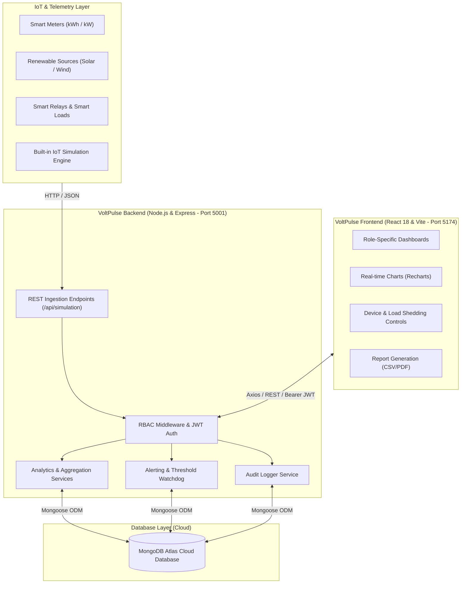

# VoltPulse – Smart Energy Consumption & IoT Load Monitoring Dashboard

[](https://reactjs.org/)
[](https://vitejs.dev/)
[](https://tailwindcss.com/)
[](https://nodejs.org/)
[](https://expressjs.com/)
[](https://www.mongodb.com/atlas)
[](https://www.docker.com/)
[](https://kubernetes.io/)
[](https://opensource.org/licenses/MIT)

VoltPulse is an enterprise-grade Smart Energy Consumption Monitoring and IoT Load Management platform designed for smart commercial buildings, industrial facilities, and university campuses. It provides real-time telemetry streaming, multi-tier Role-Based Access Control (RBAC), simulated and physical IoT device ingestion, automated demand-response load shedding, predictive energy forecasting, and regulatory energy reporting.

---

## Table of Contents

1. [Project Overview](#project-overview)
2. [Problem Statement & Objectives](#problem-statement--objectives)
3. [Key Features](#key-features)
4. [System Architecture](#system-architecture)
5. [Role-Based Access Control (RBAC)](#role-based-access-control-rbac)
6. [Technology Stack](#technology-stack)
7. [Project Directory Structure](#project-directory-structure)
8. [Installation & Setup](#installation--setup)
9. [Environment Variables](#environment-variables)
10. [Database Seeding & Pre-configured Accounts](#database-seeding--pre-configured-accounts)
11. [Running the Application](#running-the-application)
12. [Docker Deployment](#docker-deployment)
13. [Kubernetes (K8s) Orchestration](#kubernetes-k8s-orchestration)
14. [API Endpoints Reference](#api-endpoints-reference)
15. [IoT Simulation Engine](#iot-simulation-engine)
16. [Troubleshooting Guide](#troubleshooting-guide)
17. [License](#license)

---

## Project Overview

Modern facilities face unprecedented volatility in electrical tariffs, strict carbon compliance standards, and unexpected peak-load penalties. **VoltPulse** bridges operational technology (IoT power meters, smart relays, sub-meters) with enterprise management tools to deliver actionable insights on power quality, energy distribution, and automated cost optimization.

### Problem Statement
Commercial infrastructure often suffers from:
- **Blind Consumption:** Lack of sub-meter level visibility leading to undetected phantom loads and energy waste.
- **Peak Demand Surcharges:** Exceeding contracted maximum demand limits during peak utility hours triggers punitive tariff rates.
- **Segmented Management:** Disconnected facility managers, energy auditors, and occupants without tailored access controls or unified reporting.
- **Power Quality Degradation:** Voltage sags, high Total Harmonic Distortion (THD), and lagging power factors damaging critical hardware.

### Project Objectives
- Enable real-time telemetry monitoring for voltage, current, active/reactive power, power factor, and frequency.
- Ingest physical IoT readings or high-fidelity simulated telemetry with start/stop/pause controls.
- Enforce strict 4-tier Role-Based Access Control on both frontend views and backend REST APIs.
- Provide automated Demand-Response load shedding based on customizable appliance priorities.
- Deliver university- and enterprise-ready compliance reports (Daily Usage, Building Comparisons, Peak Demand, and Cost Summaries) with PDF and CSV export capabilities.

---

## Key Features

- **Dynamic Live Telemetry:** Real-time power gauges, interactive consumption charts, and live power quality metrics (THD, power factor, frequency).
- **Multi-Source Generation Monitoring:** Track grid power alongside renewable sources (Solar PV, Wind Turbines, Backup Diesel Generators) and visualize renewable energy shares.
- **Hierarchical Building & Meter Management:** Full CRUD management mapping buildings to individual smart meters, floors, and rated capacities.
- **Interactive IoT Simulation Engine:** Built-in generator creating realistic stochastic diurnal load curves, configurable ingestion frequency, and manual anomaly injection.
- **Automated Smart Load Shedding:** Classify loads by priority (High, Medium, Low/Non-Essential) with automated shedding when thresholds are breached.
- **Time-of-Use (TOU) Tariff & Cost Calculator:** Multi-tier pricing structures with off-peak, shoulder, and peak billing calculations.
- **Intelligent Anomaly & Alert Engine:** Multi-severity alerting (Critical, Warning, Info) with real-time acknowledgment and resolution workflows.
- **Predictive Energy Forecasting:** Linear regression models projecting future 24-hour and 7-day consumption patterns.
- **Maintenance Ticketing System:** Create, assign, and track preventive maintenance work orders linked to specific meters and devices.
- **Immutable Audit Logging:** Complete traceability for administrative actions, role updates, device toggles, and schedule changes.

---

## System Architecture



---

## Role-Based Access Control (RBAC)

VoltPulse enforces strict role segregation. Permissions are enforced both in the client navigation and at the backend API middleware layer (`backend/src/middleware/auth.js`).

| Module / Action | Admin | Facility Manager | Energy Analyst | Building User |
| :--- | :---: | :---: | :---: | :---: |
| **User & Role Management** | Full CRUD | ❌ Denied | ❌ Denied | ❌ Denied |
| **Audit Log Viewing** | Full View | ❌ Denied | ❌ Denied | ❌ Denied |
| **Building Management** | Full CRUD | Assigned Only | Read-Only | Assigned Only |
| **Smart Load Shedding & Control** | Full Control | Full Control | ❌ Denied | ❌ Denied |
| **Operating Schedules** | Full CRUD | Assigned Only | ❌ Denied | ❌ Denied |
| **Threshold Configuration** | Full CRUD | Read-Only | Read-Only | ❌ Denied |
| **IoT Simulation Controls** | Start / Pause / Stop | Start / Pause / Stop | ❌ Denied | ❌ Denied |
| **Maintenance Work Orders** | Manage / Assign | Create / Update | Read-Only | View Status |
| **Advanced Forecasting & ML** | Full View | Full View | Full View | ❌ Denied |
| **Compliance Reports (PDF/CSV)** | Generate & Export | Generate & Export | Generate & Export | Read-Only Summary |
| **Live Telemetry & Alerts** | All Buildings | Assigned Buildings | All Buildings | Assigned Buildings |

---

## Technology Stack

### Frontend
- **Framework:** React 18 (SPA)
- **Build Tool:** Vite 5
- **Styling:** Tailwind CSS 3 (VoltPulse Custom Dark Palette)
- **Data Visualization:** Recharts, SVG Gauges
- **Icons:** Lucide React
- **HTTP Client:** Axios (interceptor with JWT auto-injection)

### Backend
- **Runtime:** Node.js 18+ (LTS)
- **Web Framework:** Express.js 4
- **Database ODM:** Mongoose 8
- **Authentication:** JSON Web Tokens (`jsonwebtoken`) & `bcryptjs`
- **CORS & Middleware:** Configured for independent cross-origin local and containerized access

### Database & Cloud
- **Engine:** MongoDB Atlas Cloud Cluster
- **Collections:** `users`, `buildings`, `devices`, `energyreadings`, `energysources`, `smartloads`, `loadschedules`, `alerts`, `thresholds`, `energyreports`, `maintenancetickets`, `auditlogs`

### Containerization & Orchestration
- **Docker:** Multi-stage production builds for frontend (Nginx) and backend (Node.js Alpine)
- **Docker Compose:** Multi-service orchestration with automated health checks
- **Kubernetes:** Full manifest suite with Namespace, ConfigMap, Secrets, Deployments, Services, and Ingress

---

## Project Directory Structure

```text
smart-energy-consumption-monitoring-dashboard/
├── .gitignore                      # Comprehensive Git exclusion rules
├── docker-compose.yml              # Local multi-container orchestration
├── package.json                    # Workspace task orchestrator
├── README.md                       # Complete platform documentation
│
├── backend/                        # Backend REST API Application
│   ├── .dockerignore
│   ├── .env.example                # Sanitized backend environment template
│   ├── .gitignore
│   ├── Dockerfile                  # Production container definition
│   ├── package.json
│   ├── package-lock.json
│   └── src/
│       ├── server.js               # Application entry point
│       ├── config/
│       │   └── db.js               # MongoDB Atlas connection & error handler
│       ├── middleware/
│       │   ├── auth.js             # JWT verification & role authorization
│       │   ├── errorHandler.js     # Centralized error middleware
│       │   └── validator.js        # Payload sanitization & validation
│       ├── models/                 # Mongoose Data Models (12 schemas)
│       │   ├── Alert.js
│       │   ├── AuditLog.js
│       │   ├── Building.js
│       │   ├── Device.js
│       │   ├── EnergyReading.js
│       │   ├── EnergyReport.js
│       │   ├── EnergySource.js
│       │   ├── LoadSchedule.js
│       │   ├── MaintenanceTicket.js
│       │   ├── SmartLoad.js
│       │   ├── Threshold.js
│       │   └── User.js
│       ├── routes/                 # Express API Route Handlers (18 routes)
│       ├── controllers/            # Controller business logic (18 controllers)
│       └── utils/
│           ├── auditLogger.js      # Immutable action logging utility
│           ├── seedData.js         # Comprehensive demo dataset seeder
│           ├── testDatabase.js     # Standalone Atlas connectivity test
│           ├── testModuleCRUD.js   # Automated API verification test suite
│           └── userStore.js        # Fallback memory store helper
│
├── frontend/                       # React 18 Single-Page Application
│   ├── .dockerignore
│   ├── .env.example                # Sanitized frontend environment template
│   ├── .gitignore
│   ├── Dockerfile                  # Multi-stage production build (Nginx)
│   ├── nginx.conf                  # Production reverse proxy & SPA router
│   ├── package.json
│   ├── package-lock.json
│   ├── postcss.config.js
│   ├── tailwind.config.js          # Dark theme color design system
│   ├── vite.config.js              # Vite server & build configuration
│   ├── index.html
│   └── src/
│       ├── main.jsx                # React DOM entry point
│       ├── App.jsx                 # Route manager & role gatekeeper
│       ├── index.css               # Global Tailwind CSS definitions
│       ├── api/
│       │   └── axios.js            # Axios client with bearer token headers
│       ├── context/
│       │   └── AuthContext.jsx     # Authentication state provider
│       ├── components/             # Reusable UI Components (18 items)
│       │   ├── AlertsList.jsx
│       │   ├── ConfirmDeleteModal.jsx
│       │   ├── ConsumptionChart.jsx
│       │   ├── DeviceBreakdown.jsx
│       │   ├── DeviceListTable.jsx
│       │   ├── DeviceManager.jsx
│       │   ├── DeviceModal.jsx
│       │   ├── DevicePerformanceWidget.jsx
│       │   ├── IoTSimulationWidget.jsx
│       │   ├── LoadControlAndScheduling.jsx
│       │   ├── LoadScheduleModal.jsx
│       │   ├── Navbar.jsx
│       │   ├── RealtimeGauge.jsx
│       │   ├── Sidebar.jsx
│       │   ├── SmartLoadManager.jsx
│       │   ├── SmartLoadModal.jsx
│       │   ├── StatCard.jsx
│       │   └── TariffCalculator.jsx
│       └── pages/                  # Role & Feature Views (21 pages)
│           ├── AccessDeniedView.jsx
│           ├── AlertsView.jsx
│           ├── AnalyticsView.jsx
│           ├── AuditLogsView.jsx
│           ├── BuildingComparisonView.jsx
│           ├── BuildingsView.jsx
│           ├── DashboardView.jsx
│           ├── DemandResponseView.jsx
│           ├── DevicesView.jsx
│           ├── EnergySourcesView.jsx
│           ├── ForecastingView.jsx
│           ├── LoginPage.jsx
│           ├── MaintenanceView.jsx
│           ├── PowerQualityView.jsx
│           ├── RegisterPage.jsx
│           ├── ReportsView.jsx
│           ├── SimulationView.jsx
│           ├── SustainabilityView.jsx
│           ├── TariffView.jsx
│           ├── ThresholdsView.jsx
│           └── UserManagementView.jsx
│
└── k8s/                            # Kubernetes Manifest Suite
    ├── namespace.yaml              # Dedicated 'smart-energy' namespace
    ├── configmap.yaml              # Non-sensitive runtime variables
    ├── secrets.yaml                # Secret templates for Atlas & JWT
    ├── backend-deployment.yaml     # Express backend deployment & service
    ├── frontend-deployment.yaml    # React/Nginx frontend deployment & service
    ├── mongo-deployment.yaml       # Optional local MongoDB pod & PVC
    ├── ingress.yaml                # NGINX Ingress rules
    └── kustomization.yaml          # Kustomize manifest bundle
```

---

## Installation & Setup

### Prerequisites
- [Node.js](https://nodejs.org/) v18.0.0 or higher
- [npm](https://www.npmjs.com/) v9.0.0 or higher
- [Git](https://git-scm.com/)
- [MongoDB Atlas](https://www.mongodb.com/atlas) account (or local MongoDB v6+)
- (Optional) [Docker Desktop](https://www.docker.com/products/docker-desktop/)

### 1. Clone the Repository
```bash
git clone https://github.com/kushalmandal94-lang/smart-energy-consumption-monitoring-dashboard.git
cd smart-energy-consumption-monitoring-dashboard
```

### 2. Install Dependencies
Install all backend and frontend dependencies in one command from the project root:
```bash
npm run install:all
```
*Or install separately:*
```bash
# Backend
cd backend && npm install

# Frontend
cd ../frontend && npm install
cd ..
```

---

## Environment Variables

### Backend Configuration (`backend/.env`)
Create a `.env` file inside the `backend/` directory based on `backend/.env.example`:

```env
# Server Port (Configured to avoid conflict with hospital management systems)
PORT=5001
NODE_ENV=development

# MongoDB Atlas Connection URI
MONGO_URI=mongodb+srv://<username>:<password>@<cluster-host>/smart_energy_db?retryWrites=true&w=majority

# JWT Authentication Secret & Expiration
JWT_SECRET=volt_pulse_super_secret_jwt_key_2026_secure
JWT_EXPIRES_IN=7d

# Allowed Frontend Client URL (CORS)
CLIENT_URL=http://localhost:5174
```

> [!IMPORTANT]
> Ensure your IP address is whitelisted in your MongoDB Atlas Dashboard under **Security > Network Access** (`0.0.0.0/0` allowed for local development).

### Frontend Configuration (`frontend/.env`)
Create a `.env` file inside the `frontend/` directory based on `frontend/.env.example`:

```env
# Backend API Base URL
VITE_API_URL=http://localhost:5001/api
```

---

## Database Seeding & Pre-configured Accounts

VoltPulse includes a seeding utility that populates your database with buildings, energy meters, solar arrays, smart loads, alerts, and user accounts for all 4 roles.

Run the seeder from the project root:
```bash
npm run seed
```

### Demo Accounts for Evaluation

| Role | Email Address | Password | Assigned Scope |
| :--- | :--- | :--- | :--- |
| **System Administrator** | `admin@voltpulse.io` | `Admin@123` | Global System Access |
| **Facility Manager** | `facility@voltpulse.io` | `Facility@123` | Engineering Block & Science Center |
| **Energy Analyst** | `analyst@voltpulse.io` | `Analyst@123` | Analytics, Reports & Forecasting |
| **Building User** | `user@voltpulse.io` | `User@123` | Engineering Block (Occupant) |

---

## Running the Application

Both services can be run concurrently or in separate terminals.

### Method A: Run via Root Orchestrator (Single Terminal)
```bash
# Start backend on http://localhost:5001
npm run dev:backend

# Start frontend on http://localhost:5174 (in a separate terminal)
npm run dev:frontend
```

### Method B: Manual Execution

#### 1. Start the Backend Server:
```bash
cd backend
npm run dev
```
*Expected Output:*
```text
✅ MongoDB Connected Successfully!
📦 Connected Database: smart_energy_db
⚡ VoltPulse Backend Server running on port 5001
```

#### 2. Start the Frontend Vite Server:
```bash
cd frontend
npm run dev
```
*Expected Output:*
```text
  VITE v5.0.8  ready in 320 ms

  ➜  Local:   http://localhost:5174/
  ➜  Network: use --host to expose
```

Open your browser and navigate to **[http://localhost:5174](http://localhost:5174)**.

---

## Docker Deployment

VoltPulse is fully containerized. You can run the entire multi-service stack with a single command.

### 1. Build and Run via Docker Compose
```bash
docker-compose up --build -d
```

### 2. Service Access Points:
- **Frontend Dashboard:** [http://localhost:5174](http://localhost:5174)
- **Backend API:** [http://localhost:5001/api](http://localhost:5001/api)

### 3. Stop Containers:
```bash
docker-compose down
```

---

## Kubernetes (K8s) Orchestration

All Kubernetes resource definitions are organized under `k8s/` using standard K8s practices.

### 1. Apply Manifests with Kustomize
```bash
kubectl apply -k k8s/
```
*Or apply manifests individually:*
```bash
kubectl apply -f k8s/namespace.yaml
kubectl apply -f k8s/configmap.yaml
kubectl apply -f k8s/secrets.yaml
kubectl apply -f k8s/backend-deployment.yaml
kubectl apply -f k8s/frontend-deployment.yaml
kubectl apply -f k8s/ingress.yaml
```

### 2. Verify Pod and Service Status
```bash
kubectl get pods -n smart-energy
kubectl get svc -n smart-energy
```

---

## API Endpoints Reference

All API routes require authentication with a Bearer JWT token (`Authorization: Bearer <token>`), except public authentication endpoints.

### Authentication (`/api/auth`)
| Method | Endpoint | Description | Permitted Roles |
| :--- | :--- | :--- | :--- |
| `POST` | `/api/auth/register` | Register a new user account | Public |
| `POST` | `/api/auth/login` | Authenticate user and receive JWT token | Public |
| `GET` | `/api/auth/me` | Retrieve authenticated user profile | Authenticated |

### Buildings (`/api/buildings`)
| Method | Endpoint | Description | Permitted Roles |
| :--- | :--- | :--- | :--- |
| `GET` | `/api/buildings` | List all buildings with real-time loads | All Roles |
| `POST` | `/api/buildings` | Register a new building | Admin |
| `PUT` | `/api/buildings/:id` | Update building details | Admin, Facility Manager |
| `DELETE` | `/api/buildings/:id` | Delete building (with dependency checks) | Admin |

### Energy Meters & Devices (`/api/devices`, `/api/meters`)
| Method | Endpoint | Description | Permitted Roles |
| :--- | :--- | :--- | :--- |
| `GET` | `/api/devices` | List all connected IoT devices & meters | All Roles |
| `POST` | `/api/devices` | Register a new energy meter or load | Admin, Facility Manager |
| `PUT` | `/api/devices/:id` | Modify device parameters | Admin, Facility Manager |
| `DELETE` | `/api/devices/:id` | Remove a device from tracking | Admin |

### IoT Simulation Engine (`/api/simulation`)
| Method | Endpoint | Description | Permitted Roles |
| :--- | :--- | :--- | :--- |
| `GET` | `/api/simulation/status` | Current simulation engine state & metrics | All Roles |
| `POST` | `/api/simulation/start` | Start live telemetry data generation | Admin, Facility Manager |
| `POST` | `/api/simulation/pause` | Pause data generation stream | Admin, Facility Manager |
| `POST` | `/api/simulation/stop` | Stop simulation engine | Admin, Facility Manager |
| `POST` | `/api/simulation/step` | Trigger a single batch telemetry cycle | Admin, Facility Manager |

### Smart Loads & Demand Response (`/api/smart-loads`, `/api/demand-response`)
| Method | Endpoint | Description | Permitted Roles |
| :--- | :--- | :--- | :--- |
| `GET` | `/api/smart-loads` | List all smart loads and priority ranks | All Roles |
| `PUT` | `/api/smart-loads/:id/toggle` | Manual on/off toggle for smart relay | Admin, Facility Manager |
| `POST` | `/api/demand-response/shed` | Trigger automated priority load shedding | Admin, Facility Manager |

### Compliance Reports (`/api/reports`)
| Method | Endpoint | Description | Permitted Roles |
| :--- | :--- | :--- | :--- |
| `GET` | `/api/reports/daily` | 24-hour hourly consumption & day comparison | All Roles |
| `GET` | `/api/reports/building-comparison` | Multi-building aggregate benchmark report | All Roles |
| `GET` | `/api/reports/peak-demand` | Peak kW demand and load factor metrics | All Roles |
| `GET` | `/api/reports/cost-tariff` | TOU cost breakdown and tariff calculations | All Roles |

### Alerts, Thresholds & Maintenance
| Method | Endpoint | Description | Permitted Roles |
| :--- | :--- | :--- | :--- |
| `GET` | `/api/alerts` | List all active and past alerts | All Roles |
| `PUT` | `/api/alerts/:id/resolve` | Acknowledge and resolve an alert | Admin, Facility Manager |
| `GET` | `/api/thresholds` | Retrieve alarm threshold parameters | All Roles |
| `PUT` | `/api/thresholds/:id` | Update power, voltage, or current limits | Admin |
| `POST` | `/api/maintenance` | Create a preventive maintenance ticket | Admin, Facility Manager |

---

## IoT Simulation Engine

VoltPulse features an integrated IoT simulation engine that emulates high-resolution smart meters without requiring physical test hardware.

### Simulation Features:
- **Realistic Diurnal Profiles:** Generates diurnal human activity curves (peaking between 09:00 and 18:00, falling during night hours).
- **Stochastic Noise:** Injects realistic continuous Gaussian variance to simulate fluctuating inductive and resistive equipment.
- **Physical vs. Simulated Flagging:** Every telemetry record carries an `isSimulated: true/false` flag to maintain audit integrity.
- **Full Power Quality Vector:** Generates Active Power ($kW$), Reactive Power ($kVAR$), Voltage ($V$), Current ($A$), Frequency ($Hz$), and Power Factor ($PF$).
- **Live UI Controls:** Facility Managers and Admins can start, pause, resume, and adjust frequency directly from the **Simulation View** in the web dashboard.

---

## Troubleshooting Guide

### 1. Port 5001 or 5174 Already in Use
- **Issue:** Another service (such as Hospital Management or another dev server) occupies the port.
- **Resolution:** Change `PORT` in `backend/.env` and `VITE_API_URL` in `frontend/.env`.

### 2. MongoDB Atlas "MongooseServerSelectionError" or "ETIMEDOUT"
- **Issue:** Your current IP address is not permitted to connect to MongoDB Atlas.
- **Resolution:**
  1. Open [MongoDB Atlas](https://cloud.mongodb.com/).
  2. Navigate to **Security > Network Access**.
  3. Click **Add IP Address** > Choose **Allow Access from Anywhere (`0.0.0.0/0`)** for development.

### 3. Authentication "Bad Credentials" or 401 Unauthorized
- **Issue:** Expired JWT token or incorrect login credentials.
- **Resolution:** Clear your browser's `localStorage` via DevTools or run `npm run seed` to reset the default demo accounts.

### 4. CORS Errors in Browser Console
- **Issue:** Frontend cannot communicate with the backend.
- **Resolution:** Verify that `CLIENT_URL=http://localhost:5174` in `backend/.env` matches the exact URL and port of your Vite frontend.

---

## Contributors & License

- **Developer:** Kushal Mandal ([@kushalmandal94-lang](https://github.com/kushalmandal94-lang))
- **Project:** VoltPulse – Smart Energy Consumption & IoT Load Monitor
- **License:** This project is licensed under the [MIT License](LICENSE).
